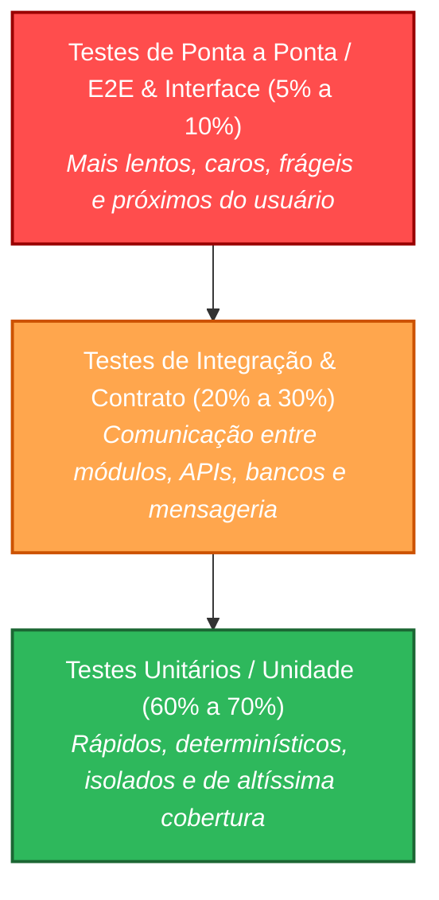
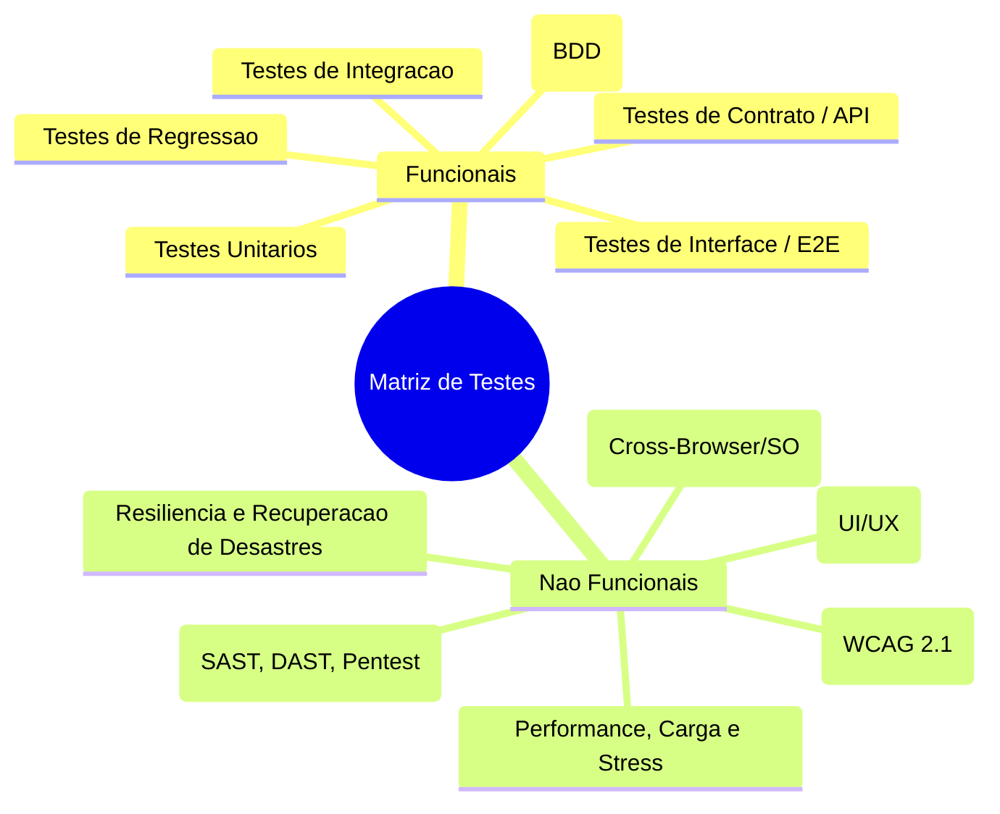
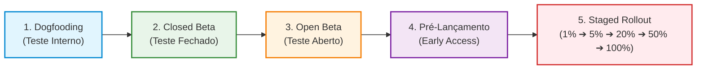
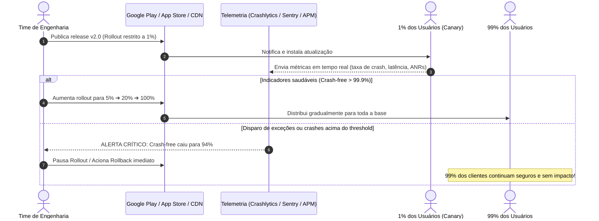
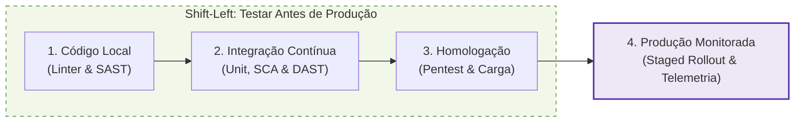

# 🚀 Guia e Estratégia de Lançamento de Software: Da Pirâmide de Testes ao Lançamento Escalonado (Staged Rollout)

> **FATEC Ferraz de Vasconcelos — Faculdade de Tecnologia de Ferraz de Vasconcelos**  
> **Curso:** Análise e Desenvolvimento de Sistemas (ADS)  
> **Professor/orientador**: Alexander Bastos 
> **Disciplina:** Teste de Software  
> **Foco:** Engenharia de Release, Pirâmide de Testes, Qualidade Contínua (QA), Segurança e Boas Práticas da Indústria  

---

## 📌 Sumário
1. [Introdução: O Desafio e a Responsabilidade do Lançamento](#1-introdução-o-desafio-e-a-responsabilidade-do-lançamento)
2. [O Custo Real do Amadorismo: Consequências de Lançar Sem Testar](#2-o-custo-real-do-amadorismo-consequências-de-lançar-sem-testar)
3. [A Pirâmide de Testes e a Matriz de Garantia da Qualidade](#3-a-pirâmide-de-testes-e-a-matriz-de-garantia-da-qualidade)
   - [3.1 Estrutura e Proporção Ideal dos Testes](#31-estrutura-e-proporção-ideal-dos-testes)
   - [3.2 O Anti-pattern "Cone de Sorvete" (Ice Cream Cone)](#32-o-anti-pattern-cone-de-sorvete-ice-cream-cone)
   - [3.3 Tipos de Testes: Funcionais e Não Funcionais](#33-tipos-de-testes-funcionais-e-não-funcionais)
4. [O Modelo das Big Techs: O Ciclo de Lançamento da Google](#4-o-modelo-das-big-techs-o-ciclo-de-lançamento-da-google)
   - [4.1 As Fases de Rollout Gradual (Do Dogfooding ao Público Global)](#41-as-fases-de-rollout-gradual-do-dogfooding-ao-público-global)
   - [4.2 Diagrama: Pipeline de Lançamento Escalonado](#42-diagrama-pipeline-de-lançamento-escalonado)
   - [4.3 Filosofia Contínua: "Monitorar, Medir e Aprimorar"](#43-filosofia-contínua-monitorar-medir-e-aprimorar)
   - [4.4 Feature Flags (Feature Toggles) e Kill Switches](#44-feature-flags-feature-toggles-e-kill-switches)
5. [O que se Pretende Revelar nos Testes em Escala? (As Falhas Invisíveis)](#5-o-que-se-pretende-revelar-nos-testes-em-escala-as-falhas-invisíveis)
6. [Erros Críticos Comuns no Lançamento e Como Evitá-los](#6-erros-críticos-comuns-no-lançamento-e-como-evitá-los)
   - [6.1 A Armadilha do *Bleeding Edge* vs. Suporte a Longo Prazo (LTS)](#61-a-armadilha-do-bleeding-edge-vs-suporte-a-longo-prazo-lts)
   - [6.2 Testes em Ambiente Único (O Falso Positivo Local)](#62-testes-em-ambiente-único-o-falso-positivo-local)
   - [6.3 Negligência com UI, UX e Acessibilidade (WCAG)](#63-negligência-com-ui-ux-e-acessibilidade-wcag)
7. [Aplicação Prática no Ambiente Acadêmico: A Cultura de Pentest e Shift-Left](#7-aplicação-prática-no-ambiente-acadêmico-a-cultura-de-pentest-e-shift-left)
8. [Checklist de Prontidão para Lançamento (Release Readiness Checklist)](#8-checklist-de-prontidão-para-lançamento-release-readiness-checklist)

---

## 1. Introdução: O Desafio e a Responsabilidade do Lançamento

Em empresas maduras de tecnologia, o lançamento de software (*Release Engineering*) não é um mero comando de envio de código ou publicação de binário em uma loja de aplicativos. Trata-se de um processo disciplinado, multidisciplinar e rigorosamente planejado que abrange desde a automação de testes até a infraestrutura de observabilidade e gestão de riscos.

Para que um software entre em produção com sucesso:
- Cada etapa do pipeline deve ser validada por critérios de aceite objetivos (*Quality Gates*);
- A equipe técnica deve compreender não apenas como construir a funcionalidade, mas como ela se comporta em cenários adversos de escala, rede e concorrência;
- A mentalidade de tolerância zero com falhas evitáveis deve guiar todas as decisões de engenharia.

---

## 2. O Custo Real do Amadorismo: Consequências de Lançar Sem Testar

> [!WARNING]
> **A ilusão do "Lança agora, conserta depois":**  
> Desenvolvedores em início de carreira frequentemente caem no erro primário de publicar código assim que a primeira execução local é concluída, usando os usuários finais como testadores inadvertidos. Essa postura é considerada inaceitável na indústria contemporânea.

As consequências de um lançamento precipitado sem validação sólida podem ser devastadoras em múltiplas esferas:

| Esfera de Impacto | Consequência Real | Exemplos Típicos |
| :--- | :--- | :--- |
| **Reputação e Carreira** | Destruição de credibilidade profissional, perda de contratos, rebaixamento de avaliação de app nas lojas (App Store / Google Play). | Aplicativo com nota 1.2 que trava na inicialização; perda de clientes em massa para concorrentes. |
| **Prejuízos Financeiros** | Interrupção de faturamento (*downtime*), custos astronômicos de correção emergencial (*hotfixes*), perda de valor de mercado e multas contratuais. | Bugs em sistemas de pagamentos cobrando valores duplicados ou travando o checkout na Black Friday. |
| **Responsabilidade Legal e Criminal** | Violações da LGPD (Lei Geral de Proteção de Dados - Lei nº 13.709/2018), do Marco Civil da Internet e do Código de Defesa do Consumidor, podendo gerar sanções da ANPD e ações penais. | Exposição de credenciais, injeção de SQL em endpoints públicos vazando CPFs, endereços e prontuários médicos. |

> [!CAUTION]
> **Lição Fundamental:** Corrigir um bug em produção custa, em média, de **30 a 100 vezes mais** do que identificá-lo e resolvê-lo nas fases iniciais de desenvolvimento e testes unitários (conforme métricas do *NIST* e de *Steve McConnell* em *Code Complete*).

---

## 3. A Pirâmide de Testes e a Matriz de Garantia da Qualidade

A garantia da qualidade de software não se resume a clicar em botões na tela para ver se a interface responde. Uma suíte de testes profissional é estruturada de forma proporcional, equilibrando custo, velocidade e abrangência.

### 3.1 Estrutura e Proporção Ideal dos Testes

Proposta originalmente por **Mike Cohn** e expandida por **Martin Fowler**, a Pirâmide de Testes dita que a base deve conter muitos testes rápidos e baratos, enquanto o topo contém menos testes, mais lentos e integrados:

### 3.2 O Anti-pattern "Cone de Sorvete" (Ice Cream Cone)

Quando a equipe negligencia os testes unitários e de integração, concentrando os esforços apenas em testes manuais ou em testes lentos de tela (E2E), forma-se o infame **Cone de Sorvete**:
- Testes que demoram horas para rodar no pipeline;
- Alta taxa de falsos positivos (*flaky tests*);
- Dificuldade em apontar a causa raiz de um erro;
- Sensação permanente de insegurança a cada novo deploy.

### 3.3 Tipos de Testes: Funcionais e Não Funcionais

Enquanto o software não for submetido e aprovado em uma matriz abrangente, **não se deve sequer cogitar o lançamento em produção**:

| Categoria | Tipo de Teste | Finalidade Principal | Ferramentas de Referência |
| :--- | :--- | :--- | :--- |
| **Funcional** | **Unitário** | Testar classes, métodos e funções isoladas de qualquer dependência externa (usando *Mocks/Stubs*). | JUnit 5, Mockito, PyTest, Jest |
| **Funcional** | **Integração** | Validar a persistência com banco de dados, mensageria e comunicação entre microsserviços. | Testcontainers, Spring Boot Test, Supertest |
| **Funcional** | **Interface / E2E** | Simular a jornada completa do usuário final em navegadores ou telas móveis reais. | Playwright, Cypress, Selenium, Appium |
| **Não Funcional** | **Performance & Carga** | Avaliar taxa de transferência (*throughput*), tempo de resposta e ponto de ruptura sob concorrência intensa. | k6, Apache JMeter, Gatling |
| **Não Funcional** | **Segurança** | Encontrar vulnerabilidades de injeção, falhas de autenticação, vazamentos e portas abertas. | OWASP ZAP, SonarQube, Snyk, Semgrep |
| **Não Funcional** | **Compatibilidade** | Garantir funcionamento uniforme em múltiplos sistemas operacionais, navegadores e arquiteturas de CPU. | BrowserStack, Saucelabs, Docker multi-arch |
| **Não Funcional** | **Acessibilidade** | Tornar o sistema acessível a pessoas com deficiência (leitor de tela, contraste, navegação por teclado). | Axe Core, Lighthouse, Pa11y |
| **Não Funcional** | **Recuperação (Disaster Recovery)** | Avaliar como o sistema se recupera de quedas abruptas de energia, perda de conexões e falha de pods. | Chaos Mesh, Gremlin, Testes de Failover |

---

## 4. O Modelo das Big Techs: O Ciclo de Lançamento da Google

> *"Ok! Meu software passou em 100% dos testes unitários e de integração. Agora já posso lançar diretamente para todo mundo?"*  
> **A resposta é: Não!**

Ter todos os testes automatizados verdes em ambiente de homologação é condição **necessária, mas não suficiente**. Em ambientes de produção reais, atuam variáveis caóticas que nenhum laboratório fechado é capaz de simular perfeitamente: operadoras com alta latência, versões obscuras de SO, aparelhos com pouca memória RAM, interferências de antivírus locais e combinações imprevistas de dados.

Por isso, empresas de hiper-escala como a **Google Inc.** utilizam pipelines de publicação em anéis concêntricos (*Staged Rollout*).

### 4.1 As Fases de Rollout Gradual (Do Dogfooding ao Público Global)

1. **Teste Interno (*Dogfooding* / *Alpha Interno*):**
   - **Público:** Desenvolvedores, gerentes de produto, QA e colaboradores da própria empresa.
   - **Conceito:** *"Comer da própria ração"* (*eating your own dog food*). A equipe usa o produto no seu dia a dia real para detectar gargalos operacionais antes de qualquer contato externo.
2. **Teste Fechado (*Closed Testing* / *Beta Fechado*):**
   - **Público:** Grupo selecionado de usuários confiáveis, parceiros comerciais ou testadores cadastrados via lista fechada de e-mails.
   - **Objetivo:** Coleta qualitativa profunda de feedback sobre usabilidade, regressões pontuais e estabilidade geral em ambientes mais heterogêneos.
3. **Teste Aberto (*Open Testing* / *Beta Público*):**
   - **Público:** Qualquer usuário voluntário que aceite explicitamente receber builds experimentais na loja de aplicativos.
   - **Objetivo:** Avaliar a estabilidade com volume de milhares de aparelhos distintos e calibrar o consumo de servidores e banco de dados.
4. **Pré-registro e Acesso Antecipado (*Pre-registration* / *Early Access*):**
   - **Público:** Usuários que manifestaram interesse prévio.
   - **Objetivo:** Gerar demanda orgânica, calibrar infraestrutura de escalonamento automático (*autoscaling*) e verificar retenção de público.
5. **Lançamento Escalonado (*Canary Deployment* / *Staged Rollout*):**
   - O software **nunca** é liberado de uma só vez para 100% da base.
   - A liberação segue incrementos graduais e pausados:
     $$\mathbf{1\% \longrightarrow 5\% \longrightarrow 20\% \longrightarrow 50\% \longrightarrow 100\%}$$
   - Se a telemetria acusar anomalias no primeiro percentual (1%), a distribuição é **congelada ou revertida imediatamente**, afetando um número mínimo de clientes.

### 4.2 Diagrama: Pipeline de Lançamento Escalonado

### 4.3 Filosofia Contínua: "Monitorar, Medir e Aprimorar"

Durante cada salto de porcentagem do *Staged Rollout*, a equipe monitora três pilares sagrados de observabilidade (*SRE - Site Reliability Engineering*):

- **Crash-Free Users Rate:** Percentual de usuários que não sofreram encerramento forçado do aplicativo (a meta padrão de excelência na indústria é de no mínimo **99.9%**).
- **Taxa de ANR (*Application Not Responding*):** Ocorrências em que a interface congela e o sistema operacional sugere encerrar o app.
- **SLIs / SLOs (*Service Level Indicators & Objectives*):** Latência de resposta de APIs (ex: percentil 95 abaixo de 200ms) e consumo de taxa de erro HTTP 5xx (*Error Budget*).

### 4.4 Feature Flags (Feature Toggles) e Kill Switches

Para não depender do tempo de aprovação de uma nova versão nas lojas de aplicativos (que pode levar de 12 a 72 horas), adota-se o desacoplamento entre **Deploy** (subir o código) e **Release** (exibir a funcionalidade):

- **Feature Flags:** O código novo vai para o aplicativo "desligado" por padrão. Um servidor de configuração ativa o recurso remotamente para nichos específicos.
- **Kill Switch:** Se um recurso novo causar lentidão ou vulnerabilidade, ele é desativado instantaneamente na nuvem com um clique, sem necessidade de atualizar o aplicativo no celular do cliente.

---

## 5. O que se Pretende Revelar nos Testes em Escala? (As Falhas Invisíveis)

Existem comportamentos defeituosos que simplesmente **não se manifestam** em máquinas de desenvolvimento com processadores de última geração, 32GB de RAM e fibra ótica de 1Gbps.

Os testes de rollout revelam:

1. **Gargalos de Hardware Específico:**
   - Aparelhos com chipsets gráficos com implementações incompletas de drivers OpenGL/Vulkan;
   - Celulares com gerenciadores agressivos de economia de bateria que matam *background workers* essenciais.
2. **Efeitos de Concorrência e *Race Conditions*:**
   - Duas mil pessoas tentando comprar o último assento de um voo no mesmo milissegundo, provocando inconsistência em bancos de dados relacionais sem *locks* adequados.
3. **Flutuações e Intermitências de Rede:**
   - O comportamento do app quando o usuário transita entre Wi-Fi veloz e 3G instável dentro de um túnel ou elevador (tratamento de *timeouts*, reconexões com *exponential backoff* e cache offline).
4. **Fuga de Memória Lenta (*Memory Leaks*):**
   - Telas que retêm referências na memória e só provocam *OutOfMemoryError* após 40 minutos ininterruptos de uso contínuo.

---

## 6. Erros Críticos Comuns no Lançamento e Como Evitá-los

### 6.1 A Armadilha do *Bleeding Edge* vs. Suporte a Longo Prazo (LTS)

> [!DANGER]
> **Erro Crítico:** Construir a aplicação exigindo a primeiríssima versão experimental lançada no mercado de um runtime, framework ou sistema operacional.

- **No ecossistema Mobile (Android):**  
  Se você configurar o `minSdkVersion` para o Android mais recente (ex: API 35/36), sua aplicação cobrirá apenas uma fração minúscula do mercado (frequentemente inferior a 5% dos usuários mundiais).
  - *Boa Prática:* Configure um `minSdkVersion` que cubra pelo menos **90% a 95%** do mercado (ex: API 26+ ou 24+, conforme estatísticas atualizadas do Android Studio Distribution Dashboard) e use bibliotecas de compatibilidade (*AndroidX / Jetpack*).
- **No ecossistema Backend (Java, PHP, Node.js):**  
  Em servidores corporativos, não se usa versão não-LTS para produção crítica.
  - *Boa Prática:* Padronize ambientes em versões **LTS (Long Term Support)** (ex: Java 17 ou 21 LTS; Node.js Active LTS), garantindo patches de segurança estáveis e compatibilidade ampla de bibliotecas de terceiros.

### 6.2 Testes em Ambiente Único (O Falso Positivo Local)

> [!IMPORTANT]
> *"Mas funcionou na minha máquina Windows 11 com WSL!"*  
> Essa frase é a maior certidão de amadorismo que um desenvolvedor pode emitir.

- A aplicação deve ser testada em matrizes heterogêneas:
  - Diferentes navegadores (Chromium, Gecko/Firefox, WebKit/Safari);
  - Diferentes resoluções, densidades de pixel (DPI) e orientações;
  - Diferentes fusos horários (*Timezones* e localização UTC) e formatações de moeda/data;
  - Ambientes containerizados reproduzíveis (Docker / Podman) para eliminar discrepâncias entre máquina local e servidor de produção.

### 6.3 Negligência com UI, UX e Acessibilidade (WCAG)

Um aplicativo que funciona bem em monitor ultrawide de 27 polegadas pode se tornar completamente inoperável em uma tela de smartphone de 5.5 polegadas:
- **Elementos Clicáveis Diminutos:** Áreas de toque inferiores a 48x48 pixels em telas touchscreen geram cliques incorretos e frustração imediata;
- **Quebra de Layout com Fontes Aumentadas:** Usuários com deficiência visual costumam aumentar o tamanho da fonte do sistema. Se o app usa dimensões rígidas em pixels (`px`) em vez de unidades relativas (`rem`, `sp`), o texto transborda e cobre botões de ação cruciais;
- **Contraste e Daltonismo:** Cores com baixo contraste impossibilitam a leitura sob a luz do sol e excluem pessoas com diferentes graus de daltonismo.

---

## 7. Aplicação Prática no Ambiente Acadêmico: A Cultura de Pentest e Shift-Left

No contexto acadêmico da **FATEC**, a melhor maneira de internalizar essas práticas não é esperar a entrada em uma grande corporação após a formatura, mas sim aplicar a cultura de **Shift-Left Security** (mover a segurança para a esquerda, ou seja, para o início do desenvolvimento):

### A Proposta Prática de Simulação
Durante as disciplinas e projetos interdisciplinares (como o Projeto Integrador e Laboratórios de Testes):

1. **Submeter o Projeto a um Pentest (Testes de Intrusão):**
   - Promover testes cruzados entre equipes: a Equipe A tenta encontrar vulnerabilidades de autenticação, injeção e sessão na API da Equipe B;
   - Utilizar scanners automatizados consolidados no mercado:
     - **SAST (Static Application Security Testing):** SonarQube, Semgrep (análise de falhas direto no código fonte);
     - **SCA (Software Composition Analysis):** OWASP Dependency-Check (identificação de bibliotecas vulneráveis / CVEs);
     - **DAST (Dynamic Application Security Testing):** OWASP ZAP (simulação ativa de ataques HTTP em tempo de execução).
2. **Criar o Hábito da Validação Prévia:**
   - Tratar qualquer falha alta/crítica da lista **OWASP Top 10** (como *SQL Injection*, *Broken Authentication* ou *Security Misconfiguration*) como um bloqueio absoluto (*Build Breaker*) que impede qualquer entrega ou avaliação positiva.

---

## 8. Checklist de Prontidão para Lançamento (Release Readiness Checklist)

Antes de autorizar o deploy ou disponibilizar qualquer versão para o público, valide rigorosamente a lista abaixo:

### 🛡️ 1. Qualidade e Cobertura de Testes
- [ ] Todos os testes unitários foram executados e passaram com 100% de sucesso.
- [ ] Testes de integração com banco de dados e APIs externas foram validados em ambiente simulado (via containers/mocks).
- [ ] Testes de ponta a ponta (E2E) cobriram o fluxo crítico (*happy path*) e os principais caminhos de erro.
- [ ] Testes de carga (*load testing*) confirmaram que o sistema suporta o tráfego de pico previsto com tempo de resposta aceitável.

### 🔒 2. Segurança e Conformidade
- [ ] Nenhuma credencial, token de API, chave privada ou senha foi versionada no repositório (`.env` fora do Git).
- [ ] As dependências externas foram inspecionadas contra vulnerabilidades conhecidas (SCA / CVE scan).
- [ ] Todas as entradas de usuário passam por validação estrita e higienização contra injeções (SQLi, XSS).
- [ ] O sistema respeita as diretrizes de privacidade da LGPD (dados sensíveis criptografados em repouso e em trânsito).

### 🌐 3. Compatibilidade e Acessibilidade
- [ ] O software foi testado em múltiplos dispositivos, sistemas operacionais e resoluções de tela.
- [ ] A versão mínima suportada (SO / Navegadores) contempla pelo menos 90% da base potencial de usuários.
- [ ] A interface obedece a padrões de contraste e permite navegação por teclado / leitores de tela.

### 📊 4. Observabilidade e Plano de Contingência
- [ ] Ferramenta de monitoramento de erros e crashes em tempo real está configurada e funcional (ex: Sentry, Crashlytics).
- [ ] Métricas de saúde do sistema (CPU, memória, latência, requisições por segundo) possuem dashboards e alertas.
- [ ] Procedimento documentado de **Rollback imediato** ou desativação via **Feature Flags** testado com sucesso.
- [ ] Plano de distribuição gradual definido (1% $\rightarrow$ 5% $\rightarrow$ 20% $\rightarrow$ 50% $\rightarrow$ 100%).
